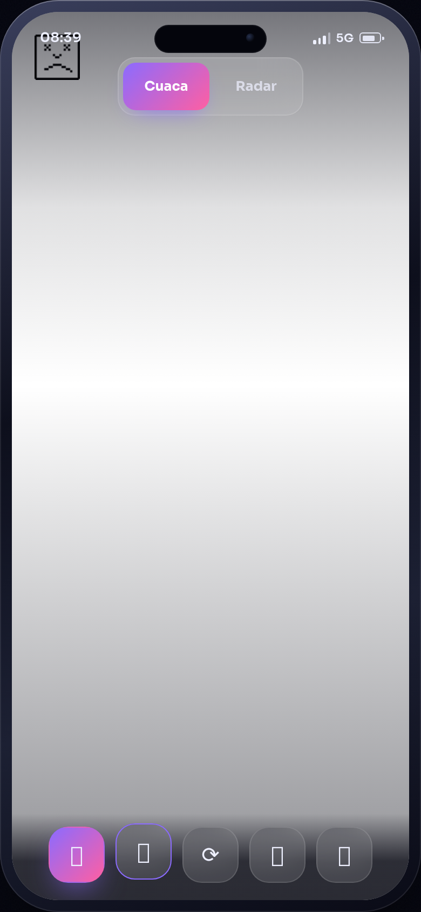
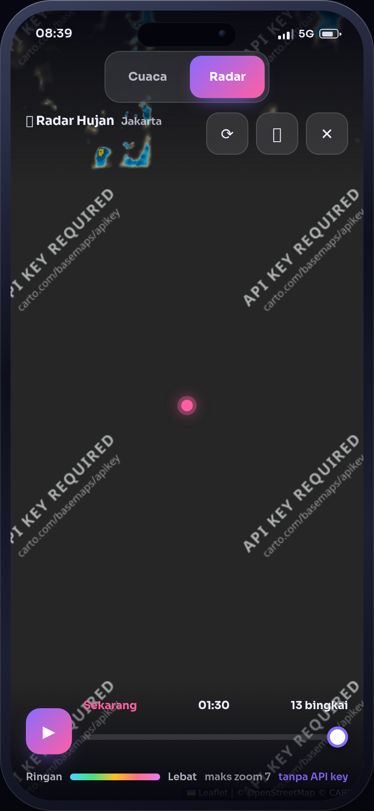
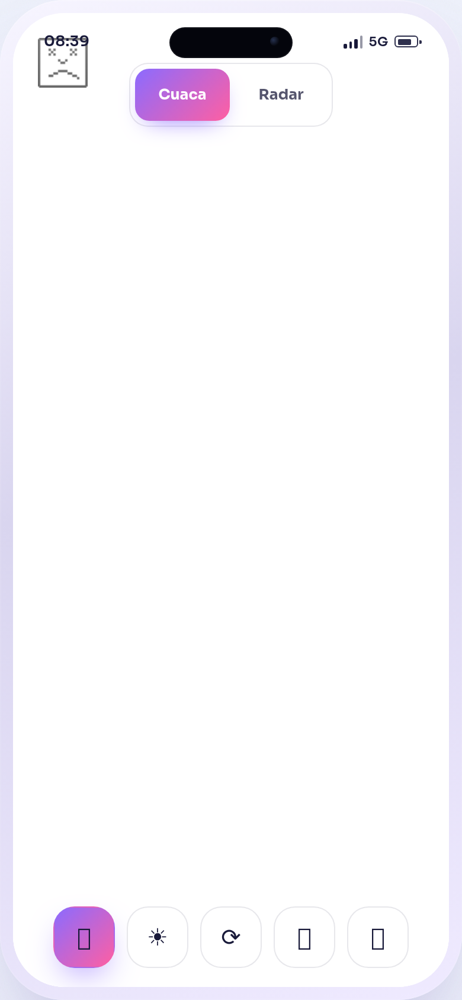

# 🌤️ Alam Semesta

Aplikasi cuaca **offline-first** berbentuk satu halaman HTML, dibungkus dalam mockup
ponsel. Menampilkan cuaca terkini, prakiraan 24 jam, prakiraan 7 hari, kualitas
udara, fase bulan, dan radar hujan beranimasi — semuanya dari API publik **tanpa
API key**.

**Demo langsung:** https://antono4.github.io/UI-aplikasi/

<p align="center">
  
  
  
</p>

---

## ✨ Fitur

- **Cuaca terkini** — suhu, suhu terasa, kelembapan, angin (arah + kecepatan),
  tekanan udara, tutupan awan, dan deskripsi kondisi dari kode cuaca WMO.
- **Catatan cuaca otomatis** — peringatan ringkas yang dihasilkan dari data
  prakiraan (badai petir, peluang hujan, UV tinggi, panas menyengat, dingin,
  angin kencang, udara buruk).
- **Hujan terdekat** — grafik curah hujan 15 menit untuk 2 jam ke depan, plus
  ringkasan teks seperti "tidak terdeteksi hujan dalam 2 jam ke depan".
- **Prakiraan per jam (24 jam)** dan **prakiraan harian (7 hari)** dengan peluang
  hujan, suhu minimum/maksimum, dan ikon siang/malam.
- **Kualitas udara** — cincin AQI Eropa, status (Sangat baik → Berbahaya), plus
  rincian PM2.5, PM10, NO₂, O₃, SO₂, dan CO.
- **Matahari & bulan** — waktu terbit/terbenam, indeks UV maksimum, dan fase bulan
  beserta persentase iluminasi.
- **Radar hujan beranimasi** — peta Leaflet dengan layer RainViewer, garis waktu
  frame, tombol putar, pusatkan ke kota, dan coba ulang. Zoom dibatasi ke level 7
  sesuai batas penyedia data.
- **Pencarian kota global** — geocoding Open-Meteo dengan pencarian bertunda,
  tombol lokasi saya (geolocation), riwayat pencarian, dan favorit (maks 8 kota)
  yang tersimpan di `localStorage`.
- **Deep link & berbagi** — posisi kota ditulis ke query string
  (`?lat=&lon=&name=`), sehingga tautan bisa dibagikan dan tombol **Bagikan**
  memakai Web Share API (fallback: salin ke clipboard).
  `?tab=radar` membuka peta radar langsung.
- **Tema gelap/terang** — mengikuti preferensi sistem saat pertama dibuka, lalu
  bisa diganti manual dan diingat.
- **Satuan °C/°F** — juga mengubah satuan angin menjadi km/j atau mph.
- **Efek suasana** — animasi canvas (hujan, salju, bintang, partikel, badai) yang
  otomatis mengikuti kondisi cuaca, atau bisa dipilih manual dan dimatikan.
- **PWA** — `manifest.webmanifest` + service worker, bisa dipasang ke layar utama
  dan tetap menampilkan data terakhir saat offline.
- **Aksesibilitas** — `aria-label`/`aria-live`/`role` pada kontrol, target sentuh
  besar, dan animasi yang dimatikan saat `prefers-reduced-motion` aktif.

## 🛠️ Teknologi

| Bagian | Dipakai |
| --- | --- |
| Markup & gaya | HTML5 + CSS3 (custom properties, `clamp()`, `backdrop-filter`) |
| Logika | JavaScript vanilla (satu IIFE, tanpa build step) |
| Peta | [Leaflet 1.9.4](https://leafletjs.com/) via unpkg |
| Peta dasar | [CARTO](https://carto.com/) (varian gelap/terang) di atas data OpenStreetMap |
| Cuaca & geocoding | [Open-Meteo](https://open-meteo.com/) (forecast, air-quality, geocoding) |
| Radar | [RainViewer](https://www.rainviewer.com/api.html) |
| Ikon & font | Emoji sistem + Google Fonts (Sora, Quicksand) |

Semua API yang dipakai **gratis dan tidak memerlukan API key**. Tidak ada
dependensi npm, tidak ada proses build, dan tidak ada backend.

## 🚀 Menjalankan Secara Lokal

Karena ini situs statis, cukup buka `index.html`. Untuk mencoba service worker
dan PWA, jalankan lewat server lokal (service worker tidak aktif pada `file://`):

```bash
python3 -m http.server 8000
# lalu buka http://localhost:8000
```

Koneksi internet tetap diperlukan untuk mengambil data cuaca, peta, dan font.

## 🗂️ Struktur Proyek

```
UI-aplikasi/
├── index.html              # Seluruh aplikasi: markup, gaya, dan logika
├── sw.js                   # Service worker (cache app-shell + network-first API)
├── manifest.webmanifest    # Metadata PWA + shortcut Radar / Jakarta
├── icons/                  # Ikon aplikasi (192, 512, maskable, SVG)
├── docs/screenshots/       # Tangkapan layar untuk README
├── .nojekyll               # Mematikan pemrosesan Jekyll di GitHub Pages
└── LICENSE                 # MIT
```

## 🔌 Endpoint yang Dipakai

| Endpoint | Kegunaan |
| --- | --- |
| `api.open-meteo.com/v1/forecast` | Cuaca terkini, per jam, harian, curah hujan 15 menit |
| `air-quality-api.open-meteo.com/v1/air-quality` | AQI dan polutan |
| `geocoding-api.open-meteo.com/v1/search` | Pencarian nama kota |
| `api.rainviewer.com/public/weather-maps.json` | Daftar frame radar |

## 🔒 Penyimpanan Data

Semua preferensi disimpan lokal di browser (`localStorage`, awalan `uia.`):
kota terpilih, tema, satuan, mode efek, favorit, riwayat, dan cache cuaca
terakhir untuk mode offline. Tidak ada data yang dikirim ke server selain
permintaan langsung ke API publik di atas.

## 📄 Lisensi

[MIT](./LICENSE) © 2026 antono4
